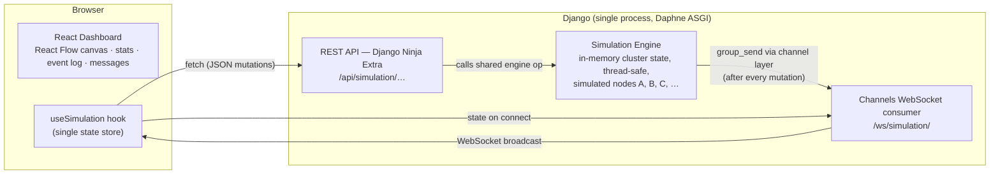

# NETVIZ — Distributed Systems Playground

An interactive, browser-based simulator for exploring how distributed systems behave under failure. Watch a simulated cluster elect leaders, replicate logs, crash, recover, and split into network partitions — and see every consequence propagate through the UI in real time.

NETVIZ demonstrates the problems distributed-consensus algorithms exist to solve: **leader failure, elections, quorum, replication reachability, and network partitions** — using a deliberately simplified, deterministic educational model (see [The educational model](#the-educational-model-simplified-raft)) rather than a full Raft implementation.

> **This is a local single-process simulation, not a real distributed cluster.** All "nodes" are data structures in one Django process. It is built for learning and demonstration, not for production use.

## Features

- **Live network canvas** (React Flow): node cards showing ID, role, status, term, log index, and partition state; links only between reachable online nodes, animated along the leader's edges.
- **Full manual control**: add nodes, crash/recover nodes, force leader elections, isolate/heal network partitions, replicate log entries, reset the cluster.
- **Leader Failure Demo**: a staged, step-by-step walkthrough — identify the leader, crash it, observe the leaderless cluster, watch an election run, and see the new leader take over. Every step is a real API call against real backend state.
- **Educational result panels**: every scenario ends with a *What happened / Why it happened / Before → After* explanation, built from actual backend snapshots — node roles, terms, log indexes and events — plus a plain-language note of the underlying concept (and an honest "simplified, single-process" disclaimer).
- **Integrity Lab**: an isolated SHA-256 hash-chain demo — three linked blocks, tamper with one, and see validation pinpoint the first invalid block. Backend-computed hashes (Python `hashlib`), no mining/peers/forks; not a cryptocurrency.
- **Real-time updates**: every REST mutation is broadcast over WebSockets to all connected dashboards.
- **Observability UI**: live cluster statistics (leader, term, health, quorum), a readable event log (elections, crashes, recoveries, partitions, replication), and a recent-messages view (heartbeats, vote requests, votes, replication).
- **Validation**: impossible transitions are rejected with clear errors (crashing an offline node, recovering an unknown node, replicating without a leader…).

## Screenshots

> Placeholders — captures are pending. After running the app, save PNGs to `docs/screenshots/` and this section will show them.

| Healthy 3-node cluster | Leader Failure Demo, mid-election |
| --- | --- |
| `docs/screenshots/dashboard.png` | `docs/screenshots/leader-failure-demo.png` |
| *Leader Node A with animated links to followers B and C* | *Crashed leader, amber election banner, event log updating* |

| Network partition isolated | Election failure (no quorum) |
| --- | --- |
| `docs/screenshots/partition.png` | `docs/screenshots/quorum-failure.png` |
| *Node B cut off from the mesh, no edges cross the partition* | *Red banner showing the actual backend failure event* |
| `docs/screenshots/integrity-lab.png` | `docs/screenshots/insight-panel.png` |
| *Hash-chain after tampering, first invalid block flagged* | *Educational What/Why/Before→After panel from a real run* |

## Architecture

One Django process owns the simulation engine — the **single source of truth**. The frontend holds no independent cluster state: it derives everything from REST responses and WebSocket pushes.



## Technology stack

| Layer | Tools |
| --- | --- |
| Frontend | React 19, TypeScript (strict), Vite, Tailwind CSS v4, [@xyflow/react](https://xyflow.com) (network canvas), Motion (animation), lucide-react (icons) |
| Backend | Python, Django, Django Ninja + Django Ninja Extra (REST API), Django Channels + Daphne (WebSockets, ASGI) |
| State | In-memory only — no database, no auth, no external services |

## Setup (Windows)

### Backend (terminal 1)

```bat
cd backend
python -m venv venv
venv\Scripts\pip install -r requirements.txt
venv\Scripts\python manage.py runserver
```

The API is now at `http://127.0.0.1:8000` (health check: `http://127.0.0.1:8000/api/health`).

- Python 3.13 was used during development; any modern Python 3.11+ should work.
- The Vite dev server proxies `/api` and `/ws`, so no CORS setup is needed.

### Frontend (terminal 2)

```bat
cd frontend
npm install
npm run dev
```

Open the URL Vite prints (by default `http://localhost:5173`). If port 5173 is already in use Vite automatically picks 5174.

## Checks and tests

```bat
:: Backend — system check and the full test suite
cd backend
venv\Scripts\python manage.py check
venv\Scripts\python manage.py test

:: Frontend — type-check and production build
cd frontend
npm run build

:: Optional — end-to-end WebSocket broadcast check (needs the dev server running)
cd backend
venv\Scripts\python scripts\ws_check.py
```

## The educational model (simplified Raft)

NETViz is a **teaching model**, not a real consensus implementation. The simplifications are intentional so that every result is deterministic and observable.

- **Cluster**: starts with three nodes — A (leader), B and C (followers), all online, term 1. Nodes can be added at runtime.
- **Quorum**: `floor(total node count / 2) + 1` counting *all* nodes, including offline ones. With 3 nodes a quorum is 2.
- **Elections**: eligible voters are nodes that are online and not isolated. The candidate with the **lexicographically smallest ID** deterministically wins (each eligible node casts its vote; the smallest eligible node stands). The term increments **only on success**. If fewer eligible nodes are reachable than quorum requires, the election fails, the term stays unchanged, and the cluster explicitly has **no leader** — nothing is faked.
- **Leader failure**: a crashed leader immediately stops being the current leader; the "Leader" statistic shows *None* until a successful election.
- **Partitions**: for the MVP, a partition isolates **one selected node** from all others. No messages involving that node are delivered across the partition, replication skips it, and it cannot vote. Healing restores connectivity. An isolated leader cannot replicate and the cluster is considered degraded.
- **Replication**: the leader increments its log index and pushes the entry to *reachable online followers* only. Log entries are just an index — there is no payload.

### In-memory state limitations

- Everything lives in one Python process. **Restarting the server (or letting the auto-reloader reload it after a code change) resets the simulation** to the initial three-node cluster.
- Two browser tabs connected to the same server share one cluster (that's the point of the WebSocket broadcast), but two separately started servers are completely independent worlds.
- Nothing is persisted: no database, no save/restore, no authentication.

## API overview

All operations return the complete simulation state (nodes, leader, term, cluster health, recent events and messages) as JSON.

| Method | Path | Purpose |
| --- | --- | --- |
| GET | `/api/health` | Backend health probe |
| GET | `/api/integrity/state` | Hash-chain integrity demo (see Integrity Lab screen) |
| POST | `/api/integrity/tamper` | Change a non-genesis block's data (index, data) |
| POST | `/api/integrity/validate` | Recompute and verify every hash and link |
| POST | `/api/integrity/reset` | Rebuild the untampered hash chain |
| GET | `/api/simulation/state` | Complete current state |
| POST | `/api/simulation/nodes` | Add a node (`node_id` optional — auto-generated if omitted) |
| POST | `/api/simulation/crash` | Crash an online node (`node_id`) |
| POST | `/api/simulation/recover` | Recover an offline node (`node_id`) |
| POST | `/api/simulation/election` | Run a simplified leader election |
| POST | `/api/simulation/partition` | Toggle network isolation for a node (`node_id`) |
| POST | `/api/simulation/replicate` | Replicate a log entry to reachable online followers |
| POST | `/api/simulation/reset` | Reset to the initial three-node cluster |
| POST | `/api/simulation/scenarios/leader-failure` | One-shot demo: crash the leader and elect a new one |

Invalid requests return structured errors, e.g. `404 {"detail": "Node 'Z' does not exist."}` or `400 {"detail": "Node 'B' is already offline."}`.

**WebSocket:** `ws://localhost:8000/ws/simulation/` (via the Vite proxy, `/ws/simulation/`). On connect the server sends the current state immediately; after every successful REST mutation the new state is broadcast to all connected clients. The dashboard reconnects automatically (up to 5 s backoff) if the socket drops.

## Known limitations

- Single-process in-memory state (see above) — no persistence, no multi-server scaling.
- Elections are instant and deterministic; there are no election timers, no candidate re-tries, no split-brain scenarios beyond single-node isolation.
- Log entries carry an index only, no contents.
- The event log keeps the last 50 events; the message list the last 25 messages.
- Dev-server security posture: `DEBUG=True`, a placeholder secret key, `ALLOWED_HOSTS = ["*"]`. **Do not expose this to the internet** — it was never meant to run anywhere but your machine.
- No frontend unit tests yet (the staged demo and API integration were verified manually and via the backend test suite); the frontend has a strict TypeScript build instead.

## Troubleshooting

| Symptom | Cause / fix |
| --- | --- |
| Dashboard stuck on "Connecting to the simulation…", REST pill red | The Django backend is not running on port 8000 — start it (terminal 1). |
| Frontend loads but nothing updates, WS pill red/disconnected | The WebSocket couldn't connect. It reconnects automatically with backoff; check that the backend runs and that nothing else proxies `/ws`. |
| `[vite] ws proxy error: ECONNABORTED` in the terminal | Harmless dev noise: the Django process (re)started while Vite's proxy held an open WebSocket. The UI reconnects on its own. |
| `WinError 10048` on `manage.py runserver` | Port 8000 is already in use — stop the other server first (or pick another port, but then update the Vite proxy target). |
| Vite printed a port other than 5173 | Port 5173 was occupied; Vite auto-bumped. The proxy still points at Django — everything keeps working. |
| `ImproperlyConfigured: ninja_extra app is not installed` | Virtual environment missing packages: run `venv\Scripts\pip install -r requirements.txt` inside `backend/`. |
| Simulation resets after a random change | The Django auto-reloader restarted the server (it watches files). This is expected in-memory behavior, not a bug. |

## How this project is built: voice-driven development

NETViz is developed with a **voice-first workflow**: requirements and review feedback are dictated with [Wispr Flow](https://wisprflow.ai) (voice-to-text dictation) and passed to [Pi](https://github.com/earendil-works/pi-coding-agent), an agent-based coding assistant that runs in the terminal. Pi reads the repository, writes and edits the code, runs the Django tests and the frontend build, and reports results back; the human reviews the diff and dictates the next step. This repo is therefore both a distributed-systems playground and a demonstration of planning, coding, testing, and verification done end-to-end through natural-language voice interaction.

## Repository layout

```
frontend/   Vite + React + TypeScript dashboard (canvas, controls, stats, logs)
backend/    Django project (natives/) + simulation app (sim/) + E2E WS checker (scripts/)
```
