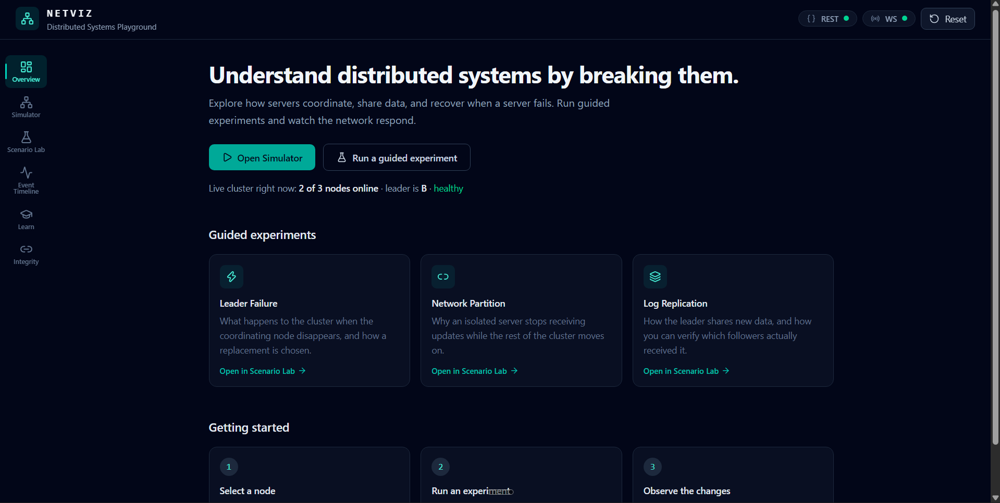
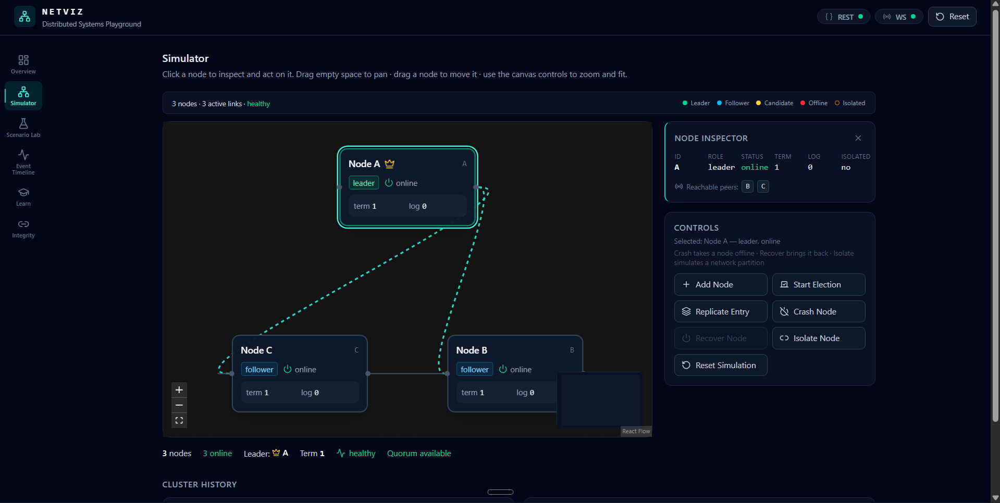
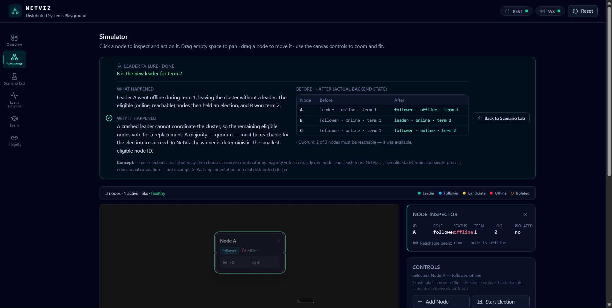
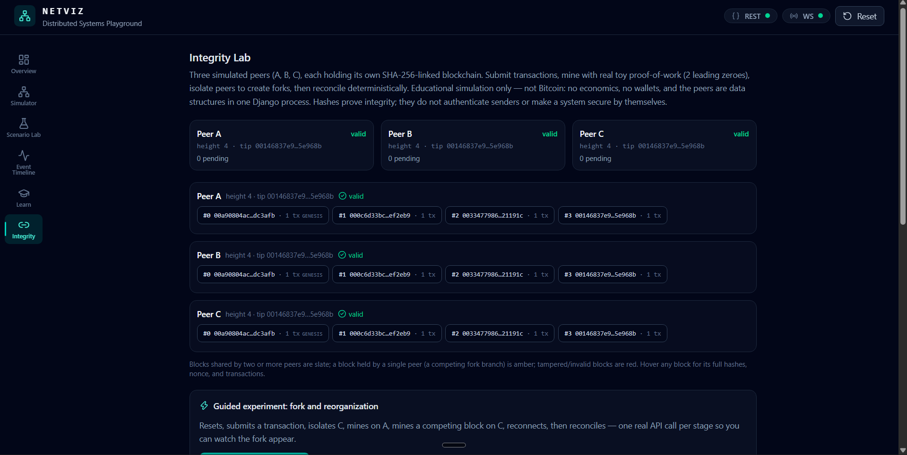
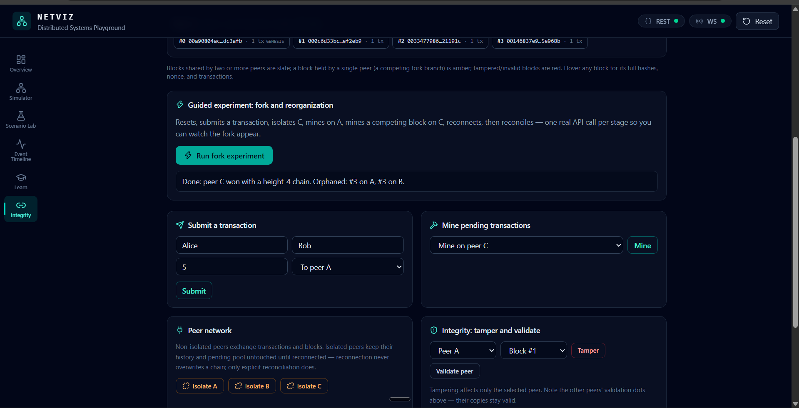
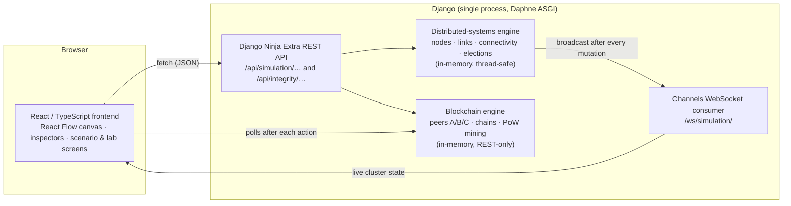

# NetViz — Interactive Distributed Systems & Blockchain Simulator

NetViz is an educational engineering playground for exploring how distributed systems behave under failure. Break a simulated cluster — crash its leader, cut network links, watch elections, quorum and replication play out — then step into a second lab where three simulated peers run a toy proof-of-work blockchain, fork it, and reconcile it.

It exists to make two ideas tangible:

- **Distributed systems**: why a crashed leader leaves a gap, why elections need a reachable majority (quorum), why network partitions cause data loss, and how replication determines who knows what.
- **Blockchain mechanics**: how SHA-256-linked blocks, proof-of-work mining, competing forks, and longest-chain reconciliation actually work — and how hashes let you detect tampering.

> **This is an educational simulation.** It is not production distributed infrastructure, not a complete Raft implementation, not Bitcoin, and not a real cryptocurrency. Every "node" and "peer" is a data structure inside one Django process; there are no independent machines, no real networks, no wallets, and no financial value. It was built for learning and demonstration.

## Screenshots

**Overview** — the starting screen, with live cluster state and guided experiments:



**Distributed systems simulator** — a selected leader node with inspector, controls, and live stats:



**Guided scenario result** — a Leader Failure run with the real before → after state from the backend:



**Blockchain / Integrity Lab** — three simulated peers with independent chains:



**Blockchain / Integrity Lab** — the guided fork experiment result and working controls:



## Contents

1. [What you can do](#what-you-can-do)
2. [Architecture](#architecture)
3. [Technology stack](#technology-stack)
4. [Getting started on Windows](#getting-started-on-windows)
5. [Commands and tests](#commands-and-tests)
6. [API overview](#api-overview)
7. [How the simulation works — and what it simplifies](#how-the-simulation-works--and-what-it-simplifies)
8. [Project structure](#project-structure)
9. [How this project was built](#how-this-project-was-built)
10. [More documentation](#more-documentation)

## What you can do

### Distributed-systems simulator

- **Live network canvas** (React Flow): node cards with role, status, term, log index and isolation state; draggable nodes, a connectivity inspector, legend, and themed minimap.
- **Node operations**: add nodes, crash and recover them, and watch leadership, health and quorum respond.
- **Leader elections**: quorum-aware — a candidate can only win from a connected group large enough to reach `floor(n/2) + 1` nodes; failed elections honestly leave the cluster without a leader.
- **Network faults**: isolate a whole node, or block/restore individual links between two nodes. Connected components and reachable peers are computed by the backend, and a node being online is explicitly distinguished from being able to reach the leader.
- **Replication**: the leader replicates a log entry to reachable followers — and the event log records exactly which followers received it and which missed it, with reasons (offline, isolated, or no active network path).
- **Live updates**: every REST mutation is pushed over a WebSocket to all connected dashboards.
- **Observability**: event log, message stream (heartbeats, votes, replication), cluster stats, and a network panel showing connected components and quorum reachability.

### Guided scenarios (with real before/after explanations)

1. **Leader Failure** — crash the leader, watch the election, see the new leader.
2. **Network Partition and Replication** — isolate a follower, replicate, and see why it misses the entry.
3. **Log Replication** — one entry to every reachable follower, with per-follower outcomes.

Each scenario ends with a *What happened / Why it happened / Before → after* panel built entirely from actual backend snapshots — no fabricated outcomes.

### Blockchain & Integrity Lab

- **Three simulated peers**, each with its own local chain, pending transaction pool, isolation flag, and validation result.
- **Transactions**: submit an illustrative record (sender, recipient, positive amount) to a peer; it propagates only to peers that can communicate.
- **Toy proof-of-work mining**: blocks are mined with SHA-256 over canonical JSON until the hash starts with two zeros (bounded nonce search); every block reports its real nonce-attempt count.
- **Forks**: isolate a peer and mine on both sides of the partition to create genuinely competing branches, all independently inspectable.
- **Reconciliation**: a deterministic longest-valid-chain rule (ties break by smallest tip hash, then peer name); losing branches are reported as orphaned blocks.
- **Integrity**: tamper with a specific peer's non-genesis block and validation pinpoints the first invalid block and the exact reason (hash mismatch, broken link, bad index, invalid structure, or unmet proof-of-work).

## Architecture

One Django process hosts two **separate** in-memory simulation services: the distributed-systems engine and the blockchain engine. They share no mutable state and serve different lessons. The cluster simulation streams live updates over a WebSocket; the blockchain lab is REST-only.



## Technology stack

| Layer | Technology |
| --- | --- |
| Frontend | React 19, TypeScript, Vite |
| Styling | Tailwind CSS v4 |
| Graph visualization | @xyflow/react (React Flow) |
| Animation | Motion |
| Icons | lucide-react |
| Backend | Django, Django Ninja, Django Ninja Extra |
| Real-time | Django Channels + Daphne (WebSocket) |
| Hashing | Python `hashlib` (SHA-256) |

No database, no authentication, no external services — everything is in-memory by design.

## Getting started on Windows

**Terminal 1 — backend:**

```bat
cd backend
python -m venv venv
venv\Scripts\pip install -r requirements.txt
venv\Scripts\python manage.py runserver
```

The API is then served at `http://127.0.0.1:8000` (health check: `http://127.0.0.1:8000/api/health`).

**Terminal 2 — frontend:**

```bat
cd frontend
npm install
npm run dev
```

Open the URL Vite prints in the terminal — usually `http://localhost:5173`. If that port is already in use, Vite picks the next free port (e.g. 5174) and prints it; the app's internal proxy to the backend works the same on any port.

## Commands and tests

```bat
:: Backend — system check and full test suite
cd backend
venv\Scripts\python manage.py check
venv\Scripts\python manage.py test

:: Frontend — TypeScript check and production build
cd frontend
npm run build

:: Optional — end-to-end WebSocket broadcast check (backend must be running)
cd backend
venv\Scripts\python scripts\ws_check.py
```

**Common issues**

| Symptom | Fix |
| --- | --- |
| `ImproperlyConfigured` or missing modules on startup | Install the requirements into the venv (see above). |
| Dashboard stuck on "Connecting…", REST pill red | The backend isn't running on port 8000 — start terminal 1. |
| Vite prints a port other than 5173 | Port was occupied; use the URL Vite prints — everything works identically. |
| `WinError 10048` when starting Django | Port 8000 is taken — stop the other process first. |
| Cluster/blockchain state resets unexpectedly | Expected: all state is in-memory and lives in the server process. A restart (or Django's auto-reloader after a code change) starts fresh. |

## API overview

All mutations return the complete updated state. Domain errors return JSON `{"detail": "..."}` with status 400 (invalid/redundant operation) or 404 (unknown node/peer); malformed request bodies return 422. Full details in [docs/API.md](docs/API.md).

| Method | Route | Purpose |
| --- | --- | --- |
| GET | `/api/health` | Health probe |
| GET | `/api/simulation/state` | Complete cluster state (nodes, leader, connectivity, events) |
| POST | `/api/simulation/nodes` | Add a node (`node_id` optional) |
| POST | `/api/simulation/crash` | Crash an online node (`node_id`) |
| POST | `/api/simulation/recover` | Recover an offline node (`node_id`) |
| POST | `/api/simulation/election` | Run a quorum-aware leader election |
| POST | `/api/simulation/partition` | Toggle isolation of a node (`node_id`) |
| POST | `/api/simulation/link/block` | Disable the link between two nodes (`node_a`, `node_b`) |
| POST | `/api/simulation/link/restore` | Restore a blocked link |
| POST | `/api/simulation/replicate` | Replicate a log entry to reachable followers |
| POST | `/api/simulation/reset` | Reset the cluster to its initial state |
| POST | `/api/simulation/scenarios/leader-failure` | One-shot leader-failure demo |
| GET | `/api/integrity/state` | Full blockchain state (peers, chains, validation) |
| POST | `/api/integrity/transaction` | Submit a transaction (`sender`, `recipient`, `amount`, `peer`) |
| POST | `/api/integrity/mine` | Mine a peer's pending transactions with toy PoW (`peer`) |
| POST | `/api/integrity/peer` | Isolate or reconnect a peer (`peer`, `isolated`) |
| POST | `/api/integrity/validate` | Validate a peer's chain (`peer`) |
| POST | `/api/integrity/tamper` | Change a non-genesis block's data on one peer (`index`, `data`, `peer`) |
| POST | `/api/integrity/reconcile` | Deterministic longest-valid-chain reconciliation |
| POST | `/api/integrity/reset` | Reset all peers to identical valid histories |

**WebSocket:** `ws://localhost:8000/ws/simulation/` — live cluster-simulation state (initial snapshot on connect, then a broadcast after every mutation). The blockchain lab is intentionally REST-only and does not use this socket.

## How the simulation works — and what it simplifies

### Distributed systems

- One in-memory engine holds the whole cluster behind a lock; a single process, single source of truth.
- Connectivity is a real graph calculation: BFS over online, non-isolated nodes with unblocked links produces the connected components, per-node reachable peers, and quorum availability that every other feature consumes.
- Elections are simplified and deterministic: eligible nodes are online, un-isolated, and reachable; the winner is the smallest node ID inside a connected group large enough for quorum. There are no election timers, retries, or split-brain resolution — the cluster has at most one leader by design.
- The model is **not** a full Raft implementation, and the nodes are not independent machines.

### Blockchain

- Three simulated peers — data structures in the same process, not independent machines.
- Blocks are SHA-256-linked over canonical JSON, and mining uses a **fixed toy difficulty** (two leading hex zeros) with a bounded nonce search — an educational stand-in for Bitcoin-style mining, not a cryptocurrency.
- Reconciliation implements longest-valid-chain selection with a documented deterministic tie-break. It does not implement the full Bitcoin protocol: no public-key signatures, no wallet or balance checks, no transaction economics, no peer discovery, and no real network.
- Hash validation demonstrates **tamper detection**. A hash proves that content is unchanged; it does not authenticate who created a transaction, and it does not make a system secure on its own.
- Known implementation limits, stated plainly: orphaned transactions are dropped rather than returned to the pool, mining races are not modelled, and difficulty is fixed.

### Development environment

The Django server runs with `DEBUG = True`, a placeholder development secret key, and permissive host settings. This is deliberate for a local educational tool — do not expose it to the internet, and don't mistake it for production configuration.

## Project structure

```
frontend/            React 19 + TypeScript + Vite app
  src/api/           typed clients for the simulation & blockchain APIs
  src/components/    canvas, inspector, panels, shell
  src/hooks/         shared state + WebSocket/scenario orchestration
  src/screens/       Overview, Simulator, Scenario Lab, Timeline, Learn, Integrity Lab
backend/
  natives/           Django project (settings, urls, ASGI, API registration)
  sim/               simulation engines, schemas, controllers, tests
    engine.py        distributed-systems engine (single source of truth)
    chain.py         blockchain simulation service
    controllers.py   /api/simulation endpoints — thin wrappers over the engine
    chain_controller.py  /api/integrity endpoints
  scripts/           ws_check.py — WebSocket end-to-end verification
docs/                architecture, API reference, development & release notes
```

## How this project was built

NetViz was developed with a voice-first workflow: requirements and review feedback were largely dictated with [Wispr Flow](https://wisprflow.ai) and handed to [Pi](https://github.com/earendil-works/pi-coding-agent), an agent-based coding assistant running in the terminal, which planned, wrote, and refactored the code across the frontend and backend. Some longer specifications were pasted into Pi as text rather than spoken. Every change was then reviewed and verified the ordinary way — reading the diff, running the Django test suite, the TypeScript build, WebSocket checks, and manual browser testing.

## Demo video

> **Pending** — the final product demo video has not been uploaded yet. The link will be inserted here when ready.

## More documentation

- [Architecture](docs/ARCHITECTURE.md) — how the engines, API and frontend fit together.
- [API reference](docs/API.md) — every route, request body, and error behaviour.
- [Development guide](docs/DEVELOPMENT.md) — setup, testing, and troubleshooting on Windows.
- [Release checklist](docs/RELEASE_CHECKLIST.md) — what remains before final submission.
